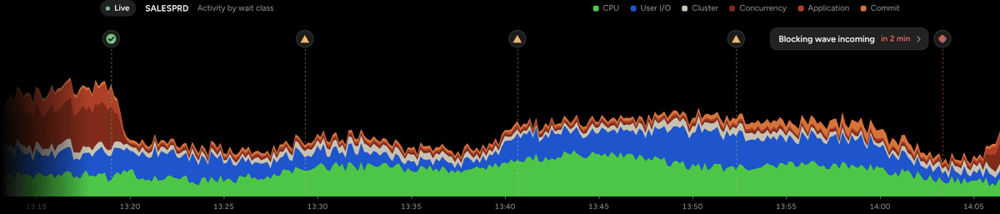
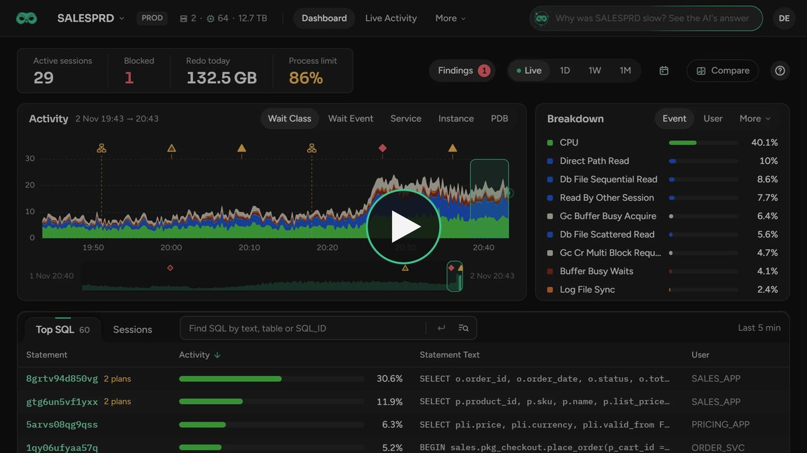

  

<h1 align="center">Scops</h1>

  <b>The most capable Oracle monitoring platform.</b> 
  The next-gen Oracle monitoring platform that thinks and acts like a DBA.

  <a href="https://scops.dev">Website</a> ·
  <a href="https://demo.scops.dev">Live demo</a> ·
  <a href="https://scops.dev/docs">Docs</a> ·
  <a href="https://scops.dev/#pricing">Download</a>

  

## Why DBAs choose Scops

**Agentless.** One read-only Oracle account through the listener. Nothing is installed on the database servers.

**No Oracle Pack required.** Session history, top SQL and plan changes without the Diagnostics or Tuning Pack, on Enterprise Edition and Standard Edition 2 alike.

**Radar Engine.** 75+ detectors catch the problems that are hardest to see coming, before they turn into incidents. It is also the most powerful way to find the root cause of the ones that already happened.

**Scops AI.** The most advanced AI assistant for Oracle, with 40+ agentic tools. It actually thinks and acts like a DBA.

**Automation, Archiving & Compression.** Statistics, datafiles, compression and archiving handled from one place.

## See it in action

  

## Get started

Community is free for 2 databases with the full product. Try the [live demo](https://demo.scops.dev) without installing anything, or [download Scops](https://scops.dev/#pricing).

## Read more

- [Best Oracle monitoring tools in 2026: 14 compared](https://scops.dev/best-oracle-monitoring-tools)
- [Oracle session history without the Diagnostics Pack](https://scops.dev/oracle-session-history-without-diagnostics-pack)
- [Oracle MCP server vs Scops AI](https://scops.dev/oracle-mcp-server-vs-scops-ai)
- [All Oracle problems and how Scops catches them](https://scops.dev/oracle-problems)

---

<a href="https://scops.dev">scops.dev</a> · <a href="mailto:hello@scops.dev">hello@scops.dev</a>

